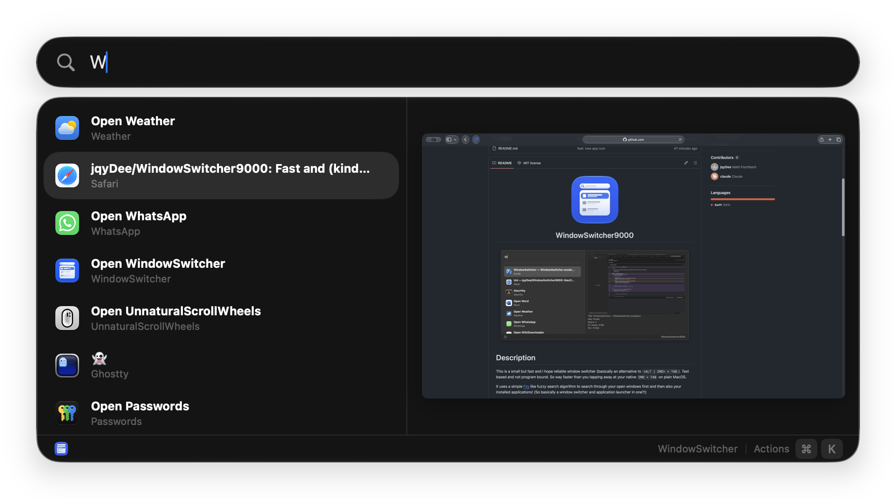

  
<!p>

<h1 align="center">WindowSwitcher9000</h1>

# Description
This is a small but fast and I hope reliable window switcher (basically an alternative to `<ALT | CMD> + TAB`). 
Text based and not program bound. So way faster than you tapping away at your native `CMD + TAB` on plain MacOS.

It uses a simple [Fzy](https://github.com/jhawthorn/fzy) like fuzzy search algorithm to search through your open windows first 
and then also your installed applications!
(So basically a window switcher and application launcher in one?!)

The Preview functionality needs Screen Capture Permissions. 
This can also be disabled in the Settings (`Appearance -> Enable Preview`) if not needed. 

The switcher is styled with the macOS Liquid Glass look, so it requires **macOS 26 or newer**.
It is currently developed and tested on macOS 27.

# Window Services
The switcher can get its windows from one of three sources. Pick one in `Settings -> General -> Window Service`:

- **[yabai](https://github.com/koekeishiya/yabai)** – the tiling window manager. Lists all windows across all spaces.
- **[AeroSpace](https://github.com/nikitabobko/AeroSpace)** – the tiling window manager. Lists all windows across all workspaces
  (floating ones included) and focusing a window also switches to its workspace.
- **Native** – no window manager needed. Uses macOS APIs directly, which unfortunately do not expose ALL windows across ALL spaces.

# Limitations
*macOS does not find it necessary to make ALL windows across ALL spaces accessible to the (power-)user!
So for the full experience you need yabai or AeroSpace; the Native service only sees what macOS is willing to show.*

Sometimes the window titles that yabai spit out are somewhat verbose (e.g. "Personal - 'github url' 'name of repo' ...").
I would like to add a dynamic filtering that can be set by the user through a GUI Filter Settings Panel for each program idividually.

# Setup
The Setup is really simple (If you have [yabai](https://github.com/koekeishiya/yabai) or [AeroSpace](https://github.com/nikitabobko/AeroSpace) ;)).

## Prebuilt
Just drag the prebuilt executable from the Latest Release to your Application Folder.

## Built yourself
Clone the Project and open it with XCode.
Build the project in XCode (Menu Bar: `Product -> Build`) and open the build folder (Menu Bar: `Product -> Show Build Folder in Finder`).
Then just drag the created Application file (`WindowSwitcher.app`) out of the Release folder into your Application folder. Start the application and go to Usage.
Goodluck!

# Usage
On first startup the Program launches with a Menu Bar icon. This can be disabled later if wanted. 

The Program then asks for Accessibility Permissions which you should grant in the System Settings
(Either through the pop-up or in `System Settings -> Privacy & Security -> Accessibility`).

In the Menu Bar menu you can open the Panel through clicking on `Toggle Switcher`.

What you probably want to do is set a global Hotkey to open the Switcher. 
This is done in the Settings (`Menu Bar menu -> Settings... -> General -> Open Switcher`): click the field and press your shortcut.
In the same place you can also choose your Window Service (yabai, AeroSpace or Native).

Now the Switcher Opens through the Hotkey. If the Preview functionality is not disabled previously in the Settings
(`Appearance -> Enable Preview` unchecked), the switcher will ask for Screen Recording Permissions
(Either through the pop-up or in `System Settings -> Privacy & Security -> Screen & System Audio Recording`)
to take snapshots of the open windows and provide you with a screenshot of the window in the Preview Panel on the right.

Without any filter text your currently open windows should
be visible. You can filter these open windows by just starting to type. 

It is also possible to start currently not running applications. These are only visible when there is a filter text. This is chosen
by design to make the list a bit less distracting. The title of all applications that can be opened starts
with `Open <application name>`.

To move the selection up the list use `<SHIFT + TAB | ARROW_UP>`. To move it down use `<TAB | ARROW_DOWN>`. To focus the selected window
press `RETURN`!

`ESC` clears the filter, and closes the panel when the filter is empty. `SHIFT + ESC` closes the panel right away and keeps the filter
for the next time you open it.

# Calculator
Type `$` to switch to the calculator: the window list is replaced by your past calculations and the result of what you type is shown on
the right of the search bar. `RETURN` saves the calculation and copies the result to the clipboard.

- Operators `+ - * / ^ %` and parentheses, implicit multiplication like `2pi` or `3(4+1)`. Only `.` is a decimal separator.
- Functions `sqrt abs ln log round floor ceil` and `sin cos tan asin acos atan` (in degrees), constants `pi`, `e` and `ans` (the last result).
- Select a past calculation with the arrow keys: `RETURN` puts it into the field, `CMD + RETURN` copies its result, `CMD + BACKSPACE` deletes it.
- `ESC` clears the field, and leaves the calculator when the field is empty.

The size of the history can be capped, and the history cleared, in `Settings -> Calculator`. To open the calculator directly, record
a hotkey under `Settings -> General -> Keyboard -> Open Calculator`; `ESC` on an empty field then closes it again.

# Clipboard History
Everything you copy (text, images and files) is kept in a history. Type `#` to open it: the list shows your copies newest first, the
preview shows the full text, the image or the files. Type to search, `RETURN` puts the selected entry back on the clipboard and closes
the panel, so `CMD + V` pastes it where you were. `CMD + BACKSPACE` deletes an entry, `ESC` clears the search and then leaves.

Copying something that is already in the history moves it to the top instead of adding it twice. Content that password managers mark
as concealed is never saved. The history stays on your Mac (`~/Library/Application Support/WindowSwitcher9000/Clipboard`); its size
and a Clear button are in `Settings -> Clipboard`. A hotkey to open it directly can be recorded under
`Settings -> General -> Keyboard -> Open Clipboard History`; `ESC` on an empty search then closes it again.

# Actions
`CMD + K` opens the action menu, Raycast-style: it lists everything you can do with the current selection together with its key.
Type to filter it, pick an action with the arrow keys and run it with `RETURN`. It also has the app toggles of the Menu Bar menu
(dock icon, debug mode) and Quit.

# Footer
*I want to make it clear that this has been my first experience writing in Swift and SwiftUI. This is my first MacOS specific
application and to be honest ChatGPT helped me a lot to create this in about 1-2 weeks. If you find weird things in this Codebase 
create a pull request and I am definitely going to have a look*

© Matti Fischbach 2025
